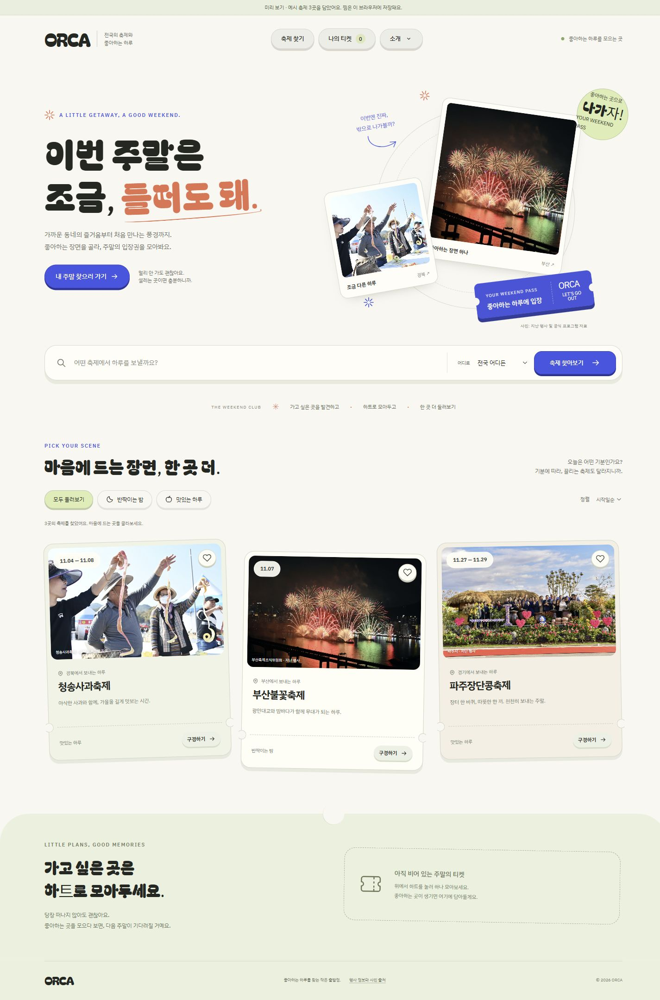
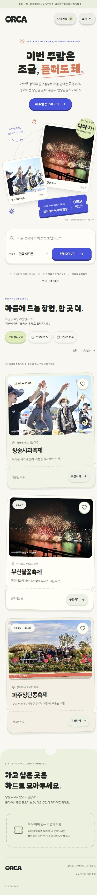

# 2026-11-02 · FE1 React 구현

작성자: 김건우 (FE1)

제출 범위가 코드 구현까지 포함된다는 팀 답변에 따라, 승인한 ‘주말의 입장권’ 컨셉을 React로 옮겼습니다.

## 구현

- 홈·축제 목록·상세·찜 페이지와 실제 URL 이동.
- 색상·글꼴·간격 기준, 버튼·카드·태그·모달·로딩·빈 결과·오류 공통 부품.
- 이름·지역·분위기 검색, 정렬, 페이지 이동.
- 찜 상태 공유·브라우저 저장·요청 중 중복 방지·실패 처리.
- 눌리는 버튼과 찜 폭죽, 모션 줄이기, 모바일 배치.
- 공유 API 초안에 맞춘 축제·추천·찜·주변 장소 요청 함수.
- FE2에게 전달할 장소 선택 부품. 실제 일정 화면에 넣는 작업은 FE2와 함께 진행 예정.

## 검증

자동 테스트와 배포용 빌드, PC·태블릿·모바일 화면 및 주요 동작을 확인했습니다. API 연결 모드는 별도의 로컬 검증 서버를 사용했습니다.

## 팀에 필요한 후속 작업

- FE3: 비어 있던 공통 진입점·라우터·헤더의 최소 코드를 검토하고 로그인/AuthContext 연결.
- BE1·BE2: 실제 서버 주소·CORS·응답 규격을 맞춘 뒤 계정 찜과 추천을 함께 확인.
- FE2: PlacePicker를 일정 화면에 연결.

실제 서버 통합과 배포까지 완료된 상태는 아닙니다. 실행·환경 설정·연결 계약은 [frontend/README.md](../frontend/README.md)에 정리했습니다.

## 제출 전 최종 확인

- 2026-11-02: 자동 테스트 15개 통과, Vite 배포용 빌드 성공.
- 최종 빌드에서 분위기 필터, 찜 저장·새로고침 후 유지·해제, 팝업의 다음 축제·Escape 닫기, 없는 검색어·초기화를 다시 확인했습니다. 브라우저 오류 로그는 없었습니다.
- PC 1440px와 모바일 390px에서 가로 넘침 없이 표시됐습니다. 태블릿 768px와 좁은 모바일 320px는 구현 단계에서 확인했고, 태블릿의 글·사진 겹침을 수정했습니다.
- 최신 원격 브랜치 be1-SH, be2-MK, fe3-HJ를 확인했으며, 현재 공유 이력은 54bcdbb입니다. 백엔드와 LoginPage/AuthContext는 비어 있어 실제 서버·계정 연결 검증은 대기 상태입니다.

### PC 화면

### 모바일 화면

