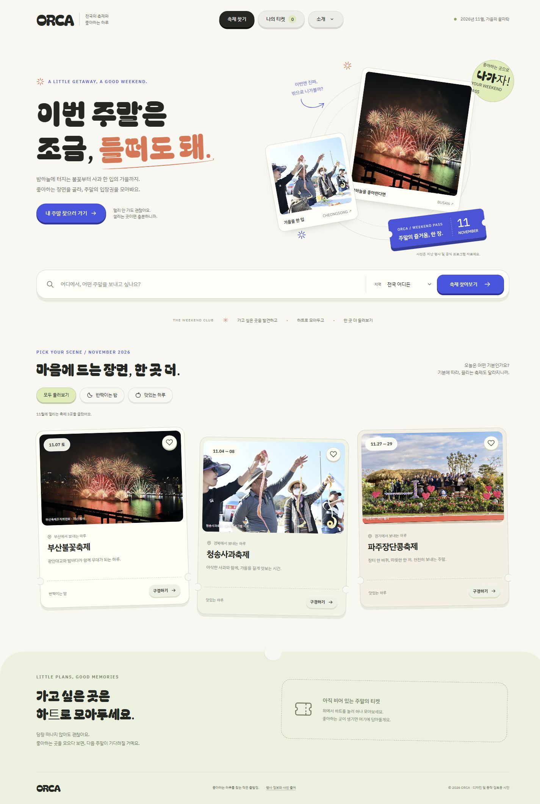
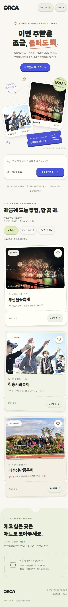

# FE1 · 축제 찾기 디자인·동작 시안

작성일: 2026-11-01  
컨셉: **주말의 입장권**

축제 사진을 둘러보고, 마음에 드는 축제를 한 장씩 모아 나만의 주말을 고르는 흐름입니다. 크림색 바탕, 둥근 제목, 겹친 사진과 입장권 모양을 기준으로 구성했습니다.

## 확인 방법

| 파일 | 내용 |
| --- | --- |
| [index.html](./index.html) | 사진과 글꼴을 포함한 동작 시안. 파일을 내려받아 Chrome에서 열어 확인합니다. |
| [desktop.jpg](./desktop.jpg) | PC 전체 화면 |
| [mobile.jpg](./mobile.jpg) | 모바일 전체 화면 |

GitHub에서 HTML을 열면 소스가 표시됩니다. 파일 화면의 **Download raw file**로 내려받은 뒤 브라우저에서 열어주세요. 별도 설치나 서버 실행 없이 확인하도록 사진과 글꼴을 포함했습니다.

## 확인할 동작

1. 상단 **소개**나 주요 버튼에 마우스를 올리거나 눌러보세요. 키보드 키처럼 살짝 내려가며 바닥 그림자가 줄어듭니다.
2. 축제 **하트**를 누르면 작은 폭죽이 한 번 퍼지고, **나의 티켓** 목록과 숫자가 갱신됩니다. 찜 해제 시 폭죽은 나오지 않습니다.
3. **반짝이는 밤 / 맛있는 하루**, 지역 선택, 축제 이름 검색으로 목록을 바꿔볼 수 있습니다.
4. 사진이나 **구경하기**를 누르면 축제 정보가 열립니다. 다음 축제를 둘러보거나 Escape로 닫을 수 있습니다.

## 구성과 범위

- 글꼴: Bagel Fat One 제목 / IBM Plex Sans KR 본문.
- 주요 색상: 크림색 바탕, 짙은 잉크색, 파랑, 주황, 연한 초록.
- 버튼 반응: 160ms. 평소 4px 바닥 그림자, 마우스를 올리면 2px 내려가고 누르면 4px 내려갑니다.
- 찜 반응: 12개의 작은 입자가 약 27–41px 범위에서 620ms 동안 퍼집니다.
- 움직임을 줄이는 기기 설정을 존중하며, 작은 화면의 주요 버튼은 44px 이상의 높이를 확보했습니다.
- 찜은 현재 브라우저에 저장합니다. 팀 서버와 연결된 사용자 계정 저장은 후속 구현 범위입니다.
- **현재 결과물은 디자인과 동작 검토용 HTML 프로토타입입니다.** Figma 원본 반영, 팀 React 프로젝트 편입, 로그인·예매·결제·서버 연동은 후속 작업입니다.

## 검증

로컬 HTTP 미리보기에서 PC 1440px와 768px·390px·320px 화면을 확인했습니다. 기분·지역·이름 검색, 검색 결과 없음, 찜과 목록의 동기화, 새로고침 후 찜 보관, 축제 미리 보기 및 다음 축제 전환을 확인했습니다. 단일 HTML의 스크립트 문법과 사진·글꼴 포함 여부도 검사했습니다.

실제 이용자의 체류 시간이나 전환율을 측정한 결과는 아직 없습니다.

## 자료 출처

- 공간감과 촉감 있는 버튼 참고: [Don't Look Up](https://www.dontlookup.app/), [Awwwards 소개](https://www.awwwards.com/sites/dont-look-up-game).
- [부산불꽃축제 공식 안내](https://www.busanfireworks.com/) / [공식 사진 갤러리](https://www.busanfireworks.com/photo).
- [청송사과축제 공식 안내](https://www.csapplefestival.kr/bbs/content.php?co_id=information) 및 공식 프로그램 사진.
- [파주시 장단콩축제 공식 안내](https://www.paju.go.kr/tour/festival/festival02/festival02_2/festival02_2_01/festival02_2_01_01.jsp) 및 지난 행사 사진.
- 글꼴: Bagel Fat One / IBM Plex Sans KR, SIL Open Font License. 라이선스 원문은 HTML 끝의 주석에 포함했습니다.

행사 일정과 장소는 공식 안내를 기준으로 구성했습니다. 사진은 지난 행사 또는 공식 프로그램 자료이며 올해 현장 사진을 뜻하지 않습니다.

## PC 시안

## 모바일 시안

